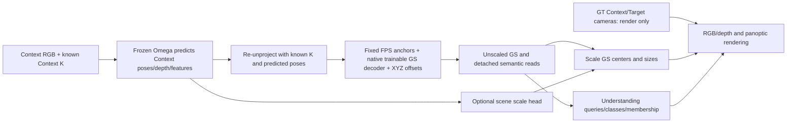

# 最新论文代码入口：QPanchor1 unposed RGB+K / GT-render 尺度头对照

更新：2026-11-01（Asia/Shanghai）。本文对应已经提交并执行冒烟的模型代码，不是对未来方案的描述。

## 版本与使用范围

- 执行源码提交：`e0be5ea0a3ab994e4288ffb492a9c8fc64cd4167`。
- 源码完整Git tree：`1af42b803e91ddbea04e3be2edf64f9c3bc07d91`。
- GitHub源码镜像提交：`515c544993be3d489bf01f4b804e85eb44d06d6b`。镜像tree与执行tree完全相同，commit不同仅因发布历史/元数据不同。
- 本发布提交在该源码tree上增加本文、论文修改提示词、协议说明和小型实验配置/审计记录。未改动任何模型代码，未上传权重或新数据集。
- `README.md`及历史docs涵盖许多旧实验；本文件是此次论文修订的权威导航，不能把所有旧分支特性合并为一个方法。
- 当前新配对是1024个固定重建锚点、每锚点64个子GS，共65536 SH1 GS、2个Context。B/D的4096 token续训仍是历史预测相机协议，不能混用。

## 推荐阅读顺序

| 顺序 | 文件 | 要回答的问题 |
|---|---|---|
| 1 | `PAPER_PROTOCOL_AND_SCALE_ZH.md` | 相机输入、坐标、尺度及与SIU3R的关系 |
| 2 | `tokengs/models/qp_anchor_unposed_gt.py` | 当前生成接口、尺度头、GT渲染及loss |
| 3 | `scripts/unposed_gt_protocol.py` | 已知K、预测Context位姿、固定单位、GT render-only约束 |
| 4 | `tokengs/models/qp_anchor_joint4.py` | QPanchor1原生重建/理解结构、L6/8/10/12读出、detach |
| 5 | `native_scannet/anchor_geometry.py` | FPS固定锚点、内容/视觉初始化、XYZ局部偏移；注意动态分支不等于启用 |
| 6 | `tokengs/models/unified_query_v1.py`、`dynamic_panoptic_controller.py`、`unified_query_loss.py` | 理解查询、类别、membership与损失 |
| 7 | `scripts/train_qp_anchor_unposed_gt.py` | fresh初始化、优化器、分支梯度隔离及更新审计 |
| 8 | `scripts/export_qp_anchor_unposed_gt.py` | 六视图导出、固定.15深度反变换及零更新 |
| 9 | `scripts/unposed_scale_pipeline.py` | 正式评分、配对门槛和ON减OFF汇总 |
| 10 | `paper_records/scale_off.configuration.json`、`scale_on.configuration.json` | 两组完整配置和实际开关 |

`qp_anchor_gt_camera.py`/`gt_camera_protocol.py`是旧有位姿条件GT诊断，不能作为当前生成路径。`AnchorQPUnposedGT`覆写了父类生成/训练/渲染路径，不能只读父类的`calibrate_targets`就断言当前使用Target RGB标定。

## Pipeline

箭头表示数据流，不表示所有箭头都可反传。理解loss不能更新原生重建、冻结Omega或尺度头；尺度头由重建loss学习。Target RGB及标签是监督/评分数据，不是生成输入。

## 实验状态与论文证据边界

本发布不重新查询调度器、不改动作业、不提交实验。最近一次已记录的检查中，OFF/ON两组8卡冒烟及CPU配对门槛均通过；OFF正式训练仍进行中，ON等待资源。该状态是先前快照，不能当实时状态或完成收据。

目前不能据此宣称尺度头提升PSNR/mIoU、保证米制尺度恢复、超过SIU3R或已完成两组正式11指标。结果要等待两组`FORMAL_COMPLETE.json`、训练终点审计和`PAIR_COMPLETE.json`通过后再写。

当前ON/OFF只隔离新增6145参数尺度头；与旧QPanchor1、旧Baseline8/C8_Cal的差值同时混有相机输入、坐标、监督与渲染协议改变。旧指标不能直接填入新版方法的结果列。当前未启用质量头，也不能把旧C8_Cal质量头或双向互惠宣称为本实现的一部分。

两组从原未训练ZERO理解初始化和原生seed42新建，不是从训练后的Baseline或旧GT v2继续训练；冻结的预训练Omega/SAM等仍是预训练资产，不应把“fresh任务训练”写成“所有模型从随机初始化训练”。
