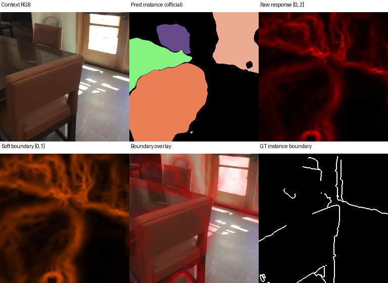
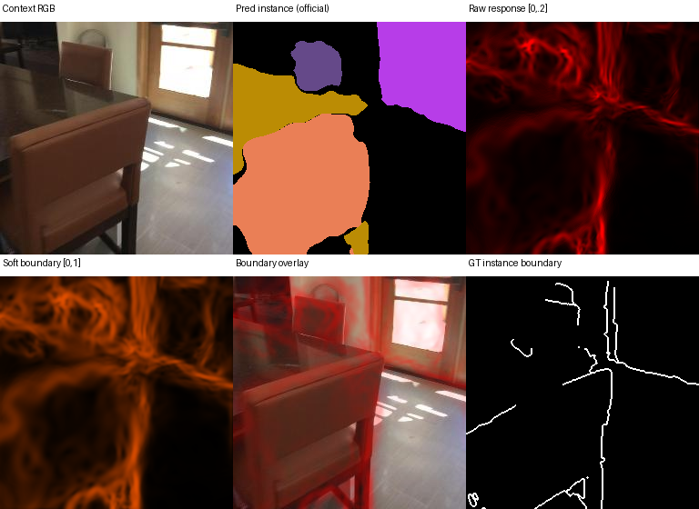

# 2026-10-22：P1024iso / No-CA 正式评测及 A4→A8 纯诊断

两项训练、两项官方1860评测、诊断 smoke 与完整128窗均正常完成（Slurm COMPLETED，exit 0）。本轮核查未提交新作业。

|作业|内容|节点 / GPU|耗时|实际结果|
|---|---|---|---|---|
|70026|P1024iso full4|13 / 8×3090|7:17:16|4 epoch / 4172 updates|
|70042|P1024iso 官方1860|13 / 8×3090|0:57:25|1860窗 / 312场景，评分成功|
|70162|P1024iso No-CA full4|12 / 8×3090|7:28:47|4 epoch / 4172 updates|
|70183|No-CA 官方1860|12 / 8×3090|1:20:41|1860窗 / 312场景，评分成功|
|70234|纯前向诊断 smoke|14 / 1×4090|0:04:57|2窗 × 两个旧checkpoint，通过|
|70235|完整128窗纯诊断|13 / 8×3090|0:11:27|128场景 × 两checkpoint，通过|

## 正式1860结果：理解退化已被确认

以下均为相同官方1860窗、312场景；mIoU/PQ/mAP用百分数。target 是既有 target-all 六视角导出口径，包含 Context，不是仅四个 novel 的指标。

|模型|PSNR↑|AbsRel↓|Context mIoU|Context PQ|Context mAP|Target mIoU|Target PQ|Target mAP|
|---|---:|---:|---:|---:|---:|---:|---:|---:|
|old_A4|18.209|0.187|55.943|65.353|20.952|55.232|63.147|19.109|
|P1024iso|18.503|0.207|54.171|62.019|17.567|53.354|59.056|15.405|
|P1024iso_NoCA|18.687|0.211|54.974|63.446|18.639|54.182|60.526|16.671|

相对旧 A4，P1024iso 的 PSNR +0.293 dB，但 Context/Target PQ -3.334/-4.091 pp，mIoU -1.772/-1.878 pp，mAP -3.385/-3.704 pp。
No-CA 相对带 CA 版本 PSNR +0.184 dB，Context/Target PQ +1.426/+1.471 pp，mIoU +0.802/+0.828 pp；仍低于旧 A4。
深度没有同步改善：AbsRel 从旧 A4 0.18695 变为0.20690/0.21118，RMSE从0.41005变为0.45148/0.46009，不能笼统称全部重建指标改善。
原4窗probe的警告被正式评测支持，但最终判断使用这里的完整评测，不把probe当正式mIoU/PQ。

## 身份、完整性与解释边界

- 两项训练8个rank各4172条连续更新记录、全部 loss/grad_norm 有限，首步权重发生更新且8rank哈希一致；最终训练收据 epoch4 / update_in_epoch0。没有声称另外测过最终8rank权重哈希。
- 正式评测权重与训练latest为同一硬链接，流式重算SHA分别为 `b8d65a659d4296ef9aeb8172cf3026c08a16b38bf1f88ae5010cbf89c0577909`、`afe21b135c46315586cbb8331c46c26edd9a9128f261fde2e93210bf6b6bee36`，与冻结收据一致。
- 三组官方1860输入RGB与GT清单一致，官方 evaluator 为 `8ea80166be76854f938e90521f1a5b688b755c87`。评测参数更新为0。
- export_complete.json 历史字段 unique_scenes 写成1860，实际是窗口数；真实场景数312，已按官方cohort/校验收据报告，不沿用该字段。
- 旧A4与P1024iso同时改变Anchor数量、seed/query初始化、2+2→2+4、FM分辨率、监督层和隔离adapter，故不能把下降单独归因于隔离。
- No-CA保留纯几何归一化权重更新c/s，不是移除几何更新；只在当前配方、单种子下支持这个方向，不能从约1.4pp PQ就裁决所有CA无效。
- 当前训练仍对全部可训练参数统一clip_grad_norm_(...,1.)。detach切断理解到重建的梯度路径，但共享clip系数使两支优化动态并非完全独立；不能把No-CA带来的0.184dB直接解释为CA伤害重建。下轮调LR/理解权重应同时记录各组裁剪前梯度与clip系数，本轮不改clip。

## A4→A4+4：共享父特征与子GS区分度

固定旧A4 epoch4 / 旧A4+4 epoch8，128个相同且不同的验证场景，每checkpoint256个Context视角。不能与上面的1860绝对指标混用。
GT归属使用全部GS正常遮挡下的渲染贡献乘GT实例mask，不使用中心投影标签。

|统计（配对场景均值）|A4|A4+4|A8−A4 的95% CI|
|---|---:|---:|---|
|全部Anchor residual/shared范数比|0.065088|0.094527|[0.028248, 0.030621]|
|跨实例Anchor residual/shared范数比|0.065263|0.090610|[0.022702, 0.027954]|
|跨实例Anchor比例|0.215799|0.189248|[-0.037155, -0.016488]|
|跨实例Anchor下 child 异实例cosine|0.999992|0.999976|[-0.000017, -0.000015]|
|跨实例Anchor下 final 异实例cosine|0.554335|0.547110|[-0.019165, 0.004564]|
|跨实例Anchor下 final 同−异cosine gap|0.303693|0.302858|[-0.013899, 0.012341]|
|跨实例Anchor下 membership 异−同JS gap|0.304123|0.299572|[-0.020888, 0.012663]|
|跨实例Anchor下 Bernoulli entropy|0.208197|0.206831|[-0.006890, 0.004252]|

结论：共享项主导原始 child 特征，异实例子GS几乎同向；续训增大residual，但最终特征与membership的同/异实例分离没有一致显著改善。跨实例Anchor比例下降，可能体现几何/贡献覆盖改善，不能当成同Anchor内部区分能力增强。
融合FM之后异实例cosine约0.55，而不是raw child的0.99999，说明最终实例区分并非只依赖共享父项。不能仅靠raw cosine证明共享Anchor导致能力上限；本轮没有移除共享项的因果消融。
纯度0.5/0.7/0.9的跨实例membership JS变化CI均跨0，判断不依赖单一纯度阈值。
128窗全部完成；主跨实例成对比较有96个可用配对场景（其它场景无足够可见/高纯度同Anchor异实例对），全部Anchor同/异实例 gap 比较有99个。不能误写成每项统计均包含128个有效配对场景。
平均每窗3922个GS，其中可分配高纯度GT的GS约1025→1083，约占26.1%→27.6%；不强行标注其余GS，结论覆盖范围受可见性/归属阈值限制。

## 连续边界：改善，但不足以进入当前Boundary-Aware RGB Loss

所有512个Context视角六图及512份raw/soft float32 NPZ本地保留；本目录只发布预定前4个窗口的16幅六图、16份连续响应NPZ。

|边界指标|A4|A4+4|
|---|---:|---:|
|BF1@2px|0.3227|0.4021|
|连续 raw AP@2px|0.3079|0.3408|
|物体内部raw响应能量占比|44.92%|44.06%|
|物体内部soft≥0.5激活率|5.92%|8.45%|

BF1提升约7.93pp（95% CI +6.23到+9.76pp），但仍偏低，且约44%的有效raw响应落在离GT边界3px之外的物体内部。连续AP有125个有效配对场景，3个没有可用GT边界的窗口不定义AP；BF1统计128窗。
人工检查固定第一窗：A8更清楚地响应门/椅子等部分轮廓，但椅背与物体内部仍有大量纹理状响应。先改善或筛选边界提取/置信度，再考虑小规模损失试验；目前不推荐直接用这张soft map作为RGB loss权重。此结论针对本次固定提取方法，不等于所有边界方法均不可行。

## 零反向与数值等价证据

诊断过程 model forward固定权重、无optimizer；backward/autograd.grad API被禁止。全部rank哈希前后一致，backward_calls=0、parameter_updates=0。
128窗所有case最大alpha守恒误差6.56e-7、one-hot特征渲染重组误差9.54e-7、转置内积相对误差1.37e-8，最终mask logits重组误差0。
源/权重/完整性收据见 POSTRUN_AUDIT.json / COMPLETE.json；原始执行commit保持 `3ac6b4f1878168929dfb3b773710acc193eb4676`，本报告提交不修改执行快照。

## 下一步建议（未提交新实验）

优先把理解下降拆成分类、漏检/重复预测、mask空间质量与stuff问题；基于下方TP/FP/FN及逐类结果决定理解侧LR或损失内部比例。不要仅凭总loss下降就继续提高总理解权重，也不再优先加容量或直接加Boundary Loss。
先保留当前两组结果作为对照；若要裁决隔离本身，必须保持P1024、FM/query初始化、输入视图、监督层一致，只改变隔离设置。

## TP / FP / FN：当前下降不是稀有类别单独造成

直接复读已保存的packed segmentation PNG，按官方同窗多视图拼接、stuff合并、IoU>0.5、双侧void面积扣除、>50% void过滤规则恢复计数。没有调用模型、渲染或反向传播。
三组×两个scope全部20类的重算PQ与正式结果逐项误差为 **0**。官方IoU为float32、SQ为float64、RQ为float32、PQ=SQ×RQ；初版全float64审计最大差2.4e-8，已对齐官方精度，未改动正式分数。

|scope|模型|thing TP|thing FP|thing FN|GT thing segments|因预测多数void而忽略的GT|
|---|---|---:|---:|---:|---:|---:|
|context|old_A4|4208|1093|1994|7298|1096|
|context|P1024iso|3911|1223|2151|7298|1236|
|context|P1024iso_NoCA|3985|1169|2125|7298|1188|
|target|old_A4|4120|1290|2154|7417|1143|
|target|P1024iso|3788|1471|2366|7417|1263|
|target|P1024iso_NoCA|3900|1363|2303|7417|1214|

以Context chair为例，旧A4→P1024iso：TP 1245→1071，FP 334→403，FN 611→726；No-CA恢复到1094/382/695，仍有差距。Context table也从612/98/189变为568/127/214。常见大类存在实质退化，不应归结为curtain等小样本类波动。
P1024iso的Context/Target逐类PQ分别16/17类低于旧A4；No-CA相对CA分别16/17类提高，支持本次改善有较广类别覆盖，但幅度约1.4pp且只有单种子，不能作为通用能力结论。
PQ官方数组顺序为packed semantic IDs [3..20,1,2]，即18个thing后wall/floor；mIoU为[1..20]。official_per_class_comparison.csv 和本计数表均已正确映射类别，不能共用同一个数组索引。
这里GT_segments是按1860个窗口分别合并视图后的计数，会跨窗口重复计数物体，不是312个场景中的唯一物理实例数。Context curtain GT=99、counter GT=155，不能套用历史128窗/其它口径的小类样本数。
官方FN会忽略预测中超过50%为void的GT。上表单列ignored_GT，避免把FN下降误读为漏检一定下降；当前CA版本ignored_GT也高于旧A4。

详细逐类PQ/mIoU/mAP见 official_per_class_comparison.csv；完整计数见 official_pq_TP_FP_FN.csv；数值一致性见 PQ_COUNTS_REPLAY_VERIFIED.json。
