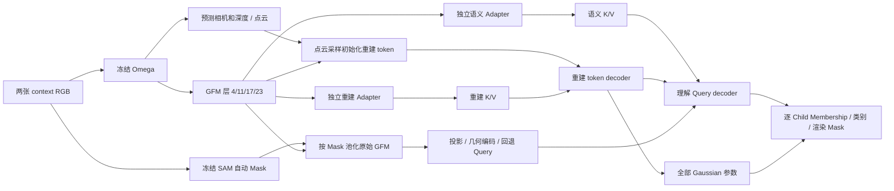

# GFM 双 Adapter 目标结构 v2

> 后续：用户要求改为SAM池化语义Adapter后的F_sem，见 [gfm_semantic_pool_v3_implementation_20261015.md](gfm_semantic_pool_v3_implementation_20261015.md)。本v2作为历史原始GFM池化方案；作业65174在训练前收据构建报错，新增训练更新0，不把提交/运行当作验证成功。

本版执行用户最终确认：同一冻结VGGT-Omega输出GFM多层特征，分别适配重建Memory与语义Memory。点云初始化重建token；SAM Mask先池化GFM再投影初始化理解query，query继续读取语义Memory及当前重建token。下游交互/Child Gaussian/分类/组装不变，Write=0。v1旧连线保留为独立模型，不回写历史代码快照。

## 代码路径与计算

入口模型 `LocusGSGFMDualStreamV2`：`tokengs/models/object_locus_gfm_dual_stream_v2.py`，注册名 `siu3r_object_locus_gfm_dual_stream_v2`，配置 `train_siu3r_object_locus_gfm_dual_stream_v2`。组件 `gfm_dual_stream_components.py`。

- Omega仍只执行一次context aggregator，输出4层 `[B,2,1024,2048]` patch特征。图像在Omega内部512×512，patch16形成32×32网格。
- 重建Adapter：每层独立LN，softmax可学习层权重融合，2048→1024投影与归一化，1024→2048 K/V投影，16头×64；最终2048个context keys。独立于语义Adapter参数。
- 原TokenGS的patch embedding、RGB/Plücker encoder、encoder norm/KV等从新模型注册参数中移除，仅保留decoder blocks。Plücker射线仍用于原几何attention bias，按照256图上的stride8平均池化，对齐Omega的32×32 keys；不能沿用旧encoder patch stride凑数。
- 重建anchor位置/半径继续由同一预测点云进行置信度网格候选＋FPS、近邻半径初始化，坐标与相机中位深度.25约定不改。采样同时返回源view/pixel ID，确保位置、RGB和GFM内容来自同一点。
- 初始重建token = 原GS可学习token + 保留的MLP([归一化XYZ,半径,RGB]) + 新的2048→1024视觉投影。视觉项通过源pixel/view在GFM上双线性取样，保留相机/采样对应关系。
- 用于初始化的“原始GFM”是4层特征各自无参数LayerNorm后平均，维度仍2048；没有先经过可训练语义Adapter。
- SAM Mask在原256网格做去重和预测3D支持估计。先area resize为32×32覆盖权重，再对2048维GFM加权池化，最后由LN/Linear/GELU/Linear投影到256维，加入区域几何编码，再LN成为query。单个像素的小候选也不会因nearest resize到低分辨率而直接消失；这不代表其语义已能被准确分辨。
- 跨视图关联仍由预测3D支持重叠与池化外观相似度共同决定；最多80候选＋至少20learned fallback，总100个thing query，另外2个stuff沿用控制器。
- 语义Adapter沿用之前的4层GFM投影融合、局部RGB残差及卷积细化，输出128×128×256语义Memory和Child视觉支撑；query初始化不依赖它的输出。没有MASt3R/COCO预训练理解分支。
- L6/8/10/12、Read、Child视觉提升、Gaussian head、类别head、panoptic组装、损失与官方评测阈值均保留；不启动Write或新增Ownership结构优化。

## 第50步资产转换，不伪称同结构精确续训

旧作业65167已在完整50步checkpoint后安全暂停；两个rank最终日志均50步，无已记录更新被丢弃。源硬链接 `/space/mawb/ssst/group_plus/dual_stream_training_v1/attempt02_node18/migration_source.pt` 已固定保存；旧作业随后因本次用户要求变更目标结构而停止，故其取消属于计划迁移，不是数值失败。

本次是明确的结构变更＋2卡→4卡，不能直接strict-load整份旧optimizer。`scripts/gfm_dual_stream_transition.py` 通过旧构造器的meta-device真实参数注册顺序，恢复原optimizer ID→参数名，再按参数名/形状逐项迁移保留参数的AdamW step、exp_avg、exp_avg_sq。

CPU实测：保留610个tensor、189,530,347参数；移除68个tensor、40,492,928参数；新增27个tensor、6,912,644参数；新模型可训练196,442,991参数。新增三个prefix只允许 `reconstruction_adapter.*`、`anchor_visual_projection.*`、`query_initializer.content_projection.*`；移除只允许旧encoder显式白名单，其他遗漏/形状变化直接报错，不使用泛化strict=False掩盖。

共享模块沿用50步权重和对应AdamW状态；新增模块有新权重和初始optimizer状态。旧0/1 rank RNG保留，新rank2/3使用确定性新种子；浮点归约顺序和GPU改变，不承诺位级一致。有效batch仍8，4卡各microbatch1、累积2；同一global update覆盖的8条样本不变，已有50步不重放。

新结构重新记录初始monitor，不拿旧连线的随机初始指标做新结构门槛。保留来源计数50，再做128/最多256次新结构更新，因此转阶段检查计数为178/306；新结构warmup从0起20更新，随后原cosine。原共享参数的AdamW moment不清空。门槛仍按原方案检查重建、实例与分类改善，新增要求重建GFM Adapter、GFM query投影、anchor视觉投影都有实际梯度及参数更新。通过后同一作业继续全量4epoch，旧50步不挤占全量4172更新。

## 验证与作业

15项CPU检查通过（旧初始化6＋训练策略/缓存4＋新GFM组件5）。新增检查覆盖K/V shape及梯度、anchor源视图、单像素SAM候选池化前后顺序及投影梯度、FPS源ID对应、旧encoder移除及两Adapter注册。真实50步checkpoint的所有共享形状、移除/新增白名单和optimizer group ID映射已核对，见新运行的 `transition_preflight.json`。

新运行根目录 `/space/mawb/ssst/group_plus/dual_stream_training_v1/attempt03_gfm_v2`；提交入口 `scripts/launch_gfm_dual_stream_v2_node18.sbatch`，固定18节点4张4090。`ARCHITECTURE_TRANSITION.json`证明迁移完成，`FIRST_UPDATE.json`证明新结构完成真实反向/更新，之后 `SHORT_PASSED.json` 才允许全量。没有这些产物前不声称相应阶段成功；最终指标未产生。

保留旧SAM/相机标定精确输入缓存，GFM语义/重建Adapter和query投影每步重算。训练与最终官方固定128场景评测口径沿既有方案，GT仅用于监督/评测，不进入生成。提交启动后停止轮询，等用户通知结果再检查。
