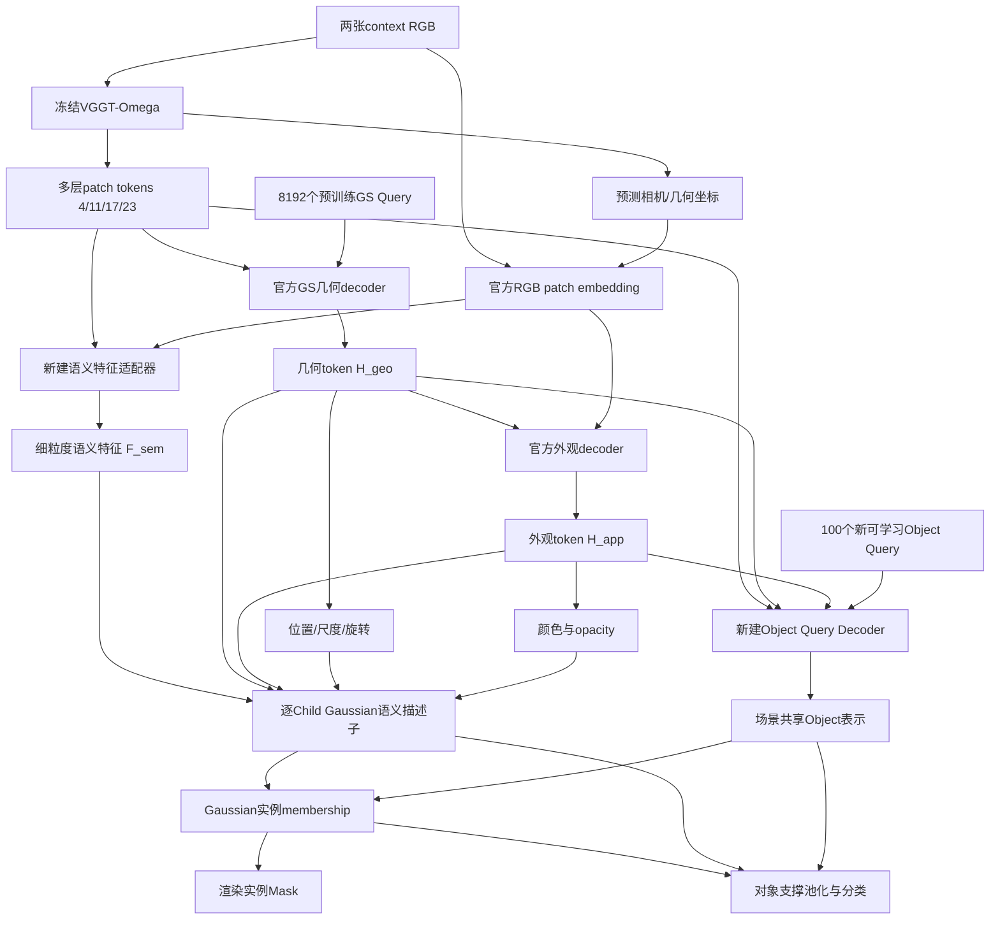

# 官方QuerySplat + VGGT-Omega：无MASt3R理解预训练的实例理解设计

状态：用户已选择**切换QuerySplat官方VGGT-Omega及配套重建权重**。本文为设计，不是已经实现/验证的模型；未下载新权重、修改当前模型或提交新作业。此前SAM候选诊断尚未执行，不作为本方案的依赖。

## 官方代码核实与新设计边界

官方仓库：https://github.com/inspatio/querysplat 。2026-10-15核对main的README、`scripts/models/querysplat.py`、`vggt_encoder.py`、`enc_dec.py`及paper/8192配置。
本地`/space/mawb/querysplat`是镜像，HEAD `3465a1d2c789d8ebe71f4f9c0bae3f2c2fd726ae`，其内容早于官方main的2026-09-18评测更新；不能直接把本地镜像称作最新官方版本。已读官方main核对核心结构，实施时需另锁定其实际commit。

官方已提供：

- 冻结VGGT-Omega aggregator/camera/depth权重；多层token经过混合、投影供重建Query读取。
- 可学习GS Query，12层重建decoder，预测Gaussian位置/尺度/旋转。
- 几何token进入6层外观decoder，读取RGB patch＋预测相机的Plücker ray tokens，输出颜色/SH与opacity。**Opacity也在外观分支，不能把该分支只称RGB head。**
- 当前paper配置：512输入、2048维GS token、8192个GS Query，每个生成64个Gaussian，合计524288个。VGGT层索引4/11/17/23；paper权重SH0，另一个8192视觉权重SH1。建议首次用paper配置/配套权重，严格成套加载。
- 发布的是推理/评测及TTO实现，不是完整原作者训练配方。下面的语义分支和训练安排是本项目新增设计，不能称为QuerySplat原生panoptic架构。

**GS Query与Object Query必须区分。** 8192个GS Query是场景重建槽位，每槽64个child不是一个完整实例；100个Object Query才负责实例集合。不能按GS父token给全部64个child硬分同一实例。

## 推荐第一版：共享骨干、三条读出，暂不新增理解写回

第一版理解读取预训练重建结果，但不改变重建token、几何、颜色或opacity。语义loss先通过新模块学习，不把随机初始化的Query反馈到官方几何decoder。这能先回答“只用VGGT体系能否学到可靠理解”，后续再独立讨论双向交互。

### A. VGGT-native语义特征适配器：替换旧F_m

去掉MASt3R image encoder、CroCo/ViT Adapter、COCO预训练Video Mask2Former及其mask embedder的加载路径；不能只清空权重但仍在旧constructor里加载它们。

从VGGT-Omega层4/11/17/23读取混合前的patch tokens，各自LN→线性投影到256维，保留深浅层身份，轻量上采样/融合形成每视图`F_sem`。这些原始层是相同32×32 patch网格、不同深度，**不是现成空间金字塔**；空间尺度需由新增decoder明确构造。复用官方RGB patch特征作为外观细节输入，新适配器从头训练。

`F_sem`承担局部Mask支撑，不能因不使用MASt3R而直接删除。旧模型诊断中，只有Anchor/geometry feature时的好候选远少于视觉融合后；这只是新设计的风险提示，不是对新VGGT-Omega语义上限的测量。

如果32×32输入的局部信息仍不足，可另测随机初始化的浅层RGB细节stem，但不与首版同时增加第二套预训练encoder或SAM。现有256图上采样到512不增加真实输入信息；若改用原始更高分辨率，需单列数据/算力差异。

### B. Object Query从哪里来

初始用100个场景共享、随机初始化的可学习256维Object Query，加2个stuff槽位。通过新建的4层Object Decoder读取VGGT多层语义memory和投影后的GS几何/外观token：

`q ← q + CA_vggt(LN(q), M_sem)`

`q ← q + CA_gs(LN(q), Proj(stopgrad(H_geo,H_app)))`

`q ← q + SA(LN(q)); q ← q + FFN(LN(q))`

两输入视图memory一起读取，每场景只产生一组Object Query，避免先得到两组实例再强行关联。第一版Read允许全局上下文，不强制与最终Mask相同，也不照抄旧L6/8/10/12插入点。上述4层/256维是首版工程配置提议，不是已经验证的最优值。

暂不增加SAM初始化，先建立不依赖其他分割预训练的可解释基线。若后续测初始化，仅替换Object Query来源，保持其他模块固定。

### C. 逐Gaussian实例归属与分类

每个child都应有可区分的语义描述子，首版可设64维以控制52万Gaussian的内存：

`f_g = MLP(Proj(H_geo[parent]), Proj(H_app[parent]), child_index, local_geometry, visible_lift(F_sem)[g])`

其中`visible_lift`复用已验证的遮挡感知renderer-adjoint归一化思想，但必须对接QuerySplat实际Gaussian/camera坐标，不能照搬旧模型的深度缩放常数。只允许读取context图像。几何与opacity冻结时，语义描述子仍能学习。

`p[g,q] = sigmoid(f_g · W_mask(q))`

将该membership渲染成2D实例Mask；同一membership和context可见质量用于对象特征池化，再由`q + pooled_object_feature`进行18类＋no-object分类，stuff单独保留2槽位。保持现有GT matching、mask BCE/Dice、分类和stuff监督的基本合同；第一版不叠加新二元objectness头、质量排序Q或强Ownership一致性损失。

该结构对所有child独立计算描述子，允许跨实例边界；不强迫parent/child/read/write相等。初始权重很弱时，不能用预测Mask把全局Read硬截断。

## 权重与训练安排

| 模块 | 初始化/第一版训练范围 |
|---|---|
| VGGT-Omega图像/跨视图骨干、相机/深度头 | 官方权重；冻结/eval |
| QuerySplat GS几何decoder、外观decoder及对应heads | 官方paper配套权重；先做数据域重建适配 |
| 语义特征适配器 | 随机初始化；训练 |
| Object Query＋4层Object Decoder | 随机初始化；训练 |
| Child语义描述子、mask/class/stuff heads | 随机初始化；训练 |
| MASt3R、ViT Adapter、COCO分割权重、旧C理解权重 | 不加载 |

这里是“理解新增模块从零训练，视觉骨干/重建有VGGT/QuerySplat预训练”，不能称整个系统无预训练。

可以保留用户熟悉的两阶段节奏：

1. **重建适配2 epoch**：官方重建模型适配相同训练场景；VGGT-Omega冻结。新底座没有当前旧模型的适配checkpoint，因此这是新实验，不是重复旧训练。
2. **理解阶段4 epoch作为首个预算**：首先冻结适配好的重建子图，训练新增理解模块。先确认训练集可拟合、Raw/分类/stuff监督正常与小物体覆盖形成；随机理解不从第一步写回重建。第一版可整个理解阶段保持重建冻结，以建立清楚的基线；若后续要联合解冻，另行锁定模块/LR/梯度路由，不能默认沿用旧模型调好的0.01就是新最优。

失去COCO分割初始化后，理解收敛速度可能不同。4 epoch是预算，不是已验证的收敛保证；需要看训练/留出曲线，不能把短期不足直接归因于VGGT不可理解。

## 实现位置与验证

- 官方`vggt_encoder.py`：增加中间patch特征的只读返回，不改变官方重建用layer mixer/norm；验证开关前后重建相同。
- 官方`querysplat.py`：明确返回`H_geo/H_app`及每Gaussian到parent的真实映射；新增panoptic包装，不覆盖原模型forward行为。
- 独立新增`semantic_adapter`、`object_query_decoder`、`gaussian_semantic_head`、`panoptic_readout`；使用新namespace，避免本仓库和QuerySplat都叫`scripts.models`产生导入冲突。
- 原始官方模型/只读feature-export模型，先通过同输入重建复现；再检查冻结/grad、两视图Query身份、parent-major64映射、renderer/lift转置及坐标、GT只用于loss/评测。
- 官方`GaussianRenderer`当前提供RGB/depth渲染，不是可直接调用的panoptic feature renderer。需另外接入分块的feature-channel rasterization和renderer-adjoint，核对alpha合成/遮挡、梯度与原RGB几何一致。52万Gaussian不做全量Gaussian对图像token的attention；Object Query读取8192个parent，child语义描述子用局部lift/MLP，mask logits按需分块，峰值内存另行实测。
- 官方repo没有完整训练入口，需要自行接入现有数据、loss、DDP、checkpoint和官方SIU3R评测；这不是仅加一个分类Linear就完成。
- 固定同训练/留出场景、2 context、同GT目标帧与官方13列；input512及52万Gaussian的计算量不同于旧模型，不称等算力。先做内存/算力实测，不能通过把8192偷偷改成1024来冒充官方checkpoint基线。
- 重点复查Raw覆盖、no-object/错类、阶段GT损失、小物体和重复候选，PSNR作为重建保持/域适配指标。当前85个旧C失败小物体可作解释性对照，但主要结论仍需在全部128场景和全体小物体上评价。

本文仅设计，尚未在新底座上得到理解指标。后续如提交作业，确认真实启动后停止轮询，等用户通知完成再分析。

官方参考：

- https://github.com/inspatio/querysplat
- https://github.com/inspatio/querysplat/blob/main/scripts/models/querysplat.py
- https://github.com/inspatio/querysplat/blob/main/scripts/models/vggt_encoder.py
- https://github.com/inspatio/querysplat/blob/main/checkpoints/querysplat_vggto_1B_512_paper.yaml
